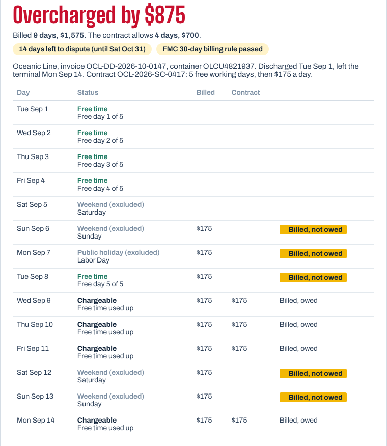

# DemurrageGuard

**AI reads the invoice. Code proves the math. A human decides.**

Agentika 2.0 · NaSCon '26 · theme: *Human + AI, Better Together*



Shipping lines bill importers a daily fee (demurrage) once a container overstays its free time. Contracts exclude weekends, holidays and port closures, but carriers bill them anyway, and US FMC rules (46 CFR 541) set 30-day windows to bill and to dispute. Checking by hand takes hours, so most teams just pay. DemurrageGuard audits an invoice in about a minute.

## How it works

1. **AI reads.** An LLM extracts carrier, container, dates and amounts from the PDF. Anything it can't read, it asks a human for.
2. **Code proves.** A pure-Python engine recomputes every billed day: contract free time, weekends, holidays, closures, terminal gate records, the FMC 30-day rules. No AI and no database inside.
3. **Two paths must agree.** An AI agent re-runs the audit through the engine's MCP server, and a guard checks it against the REST result. If they disagree, code wins.
4. **A human decides.** Pay, dispute or settle, with a reason. The AI drafts the dispute letter, and code verifies every dollar in it came from the engine before the human signs off.
5. **Everything is logged,** including every time the human overrode the AI.

| | Does | Because |
|---|---|---|
| AI | Reads PDFs, recommends, drafts | Good at language, bad at arithmetic |
| Code | Every date and every dollar | Must be exact and checkable |
| Person | The decision and the signature | Knows the carrier relationship |

**Invoice A, worked:** discharged Tue Sep 1, 5 free working days, then $175/day; billed Sep 6–14 = 9 days, $1,575. Sep 6, 12, 13 are weekends, Sep 7 is Labor Day, Sep 8 is still free day 5. Owed: 4 days, **$700. Overcharged by $875.**

## Run

```bash
python -m venv .venv && source .venv/bin/activate   # Windows: .venv\Scripts\Activate.ps1
pip install -r requirements-dev.txt
python -m pytest -q
uvicorn engine.app:app --port 8000
```

Import `n8n/demurrage-guard.json` into n8n for the full workflow (forms, LLM steps, MCP agent, guard). Operating notes: [docs/RUNBOOK.md](docs/RUNBOOK.md) · demo: [docs/DEMO_SCRIPT.md](docs/DEMO_SCRIPT.md)

<details>
<summary>Architecture, API, layout</summary>

```
 n8n workflow
   Form: upload PDF ─▶ extract text ─▶ LLM: read invoice fields
   ─▶ POST /audit ──────────────┐
   ─▶ AI agent ─ MCP client ────┤
   ─▶ Guard: agent result == REST result?
   ─▶ Form: verdict + decision (HUMAN)
   ─▶ LLM: draft letter ─▶ POST /letter/check (guard)
   ─▶ Form: edit + approve (HUMAN) ─▶ POST /decisions
                                 ▼
 Engine (this repo, Docker): FastAPI + MCP at /mcp, pure-Python rules
```

| Endpoint | Purpose |
|---|---|
| `POST /audit` | Full audit of an invoice (always 200; check `ok`) |
| `POST /letter`, `POST /letter/check` | Facts the AI may use; guard for an AI-drafted letter |
| `POST /decisions`, `GET /decisions` | Decision log |
| `/mcp` | Tools: `audit_invoice`, `get_contract`, `get_gate_events`, `get_calendar`, `check_fmc_window` |
| `GET /demo/{A,B,C}` | Sample verdicts |

```
engine/logic.py   the audit rules (pure functions, fully tested)
engine/app.py     REST endpoints, MCP server, pages
engine/data/      fictional contracts, gate records, port holidays
n8n/              the workflow
samples/          three demo invoices (overcharged, correct, billed too late)
tests/            pytest suite
```
</details>

---

Python 3.12 · FastAPI · MCP (FastMCP) · n8n · Groq `gpt-oss-120b` · Docker

All carriers, contracts and invoices are fictional. The rules are simplified for demonstration and are not legal advice.
